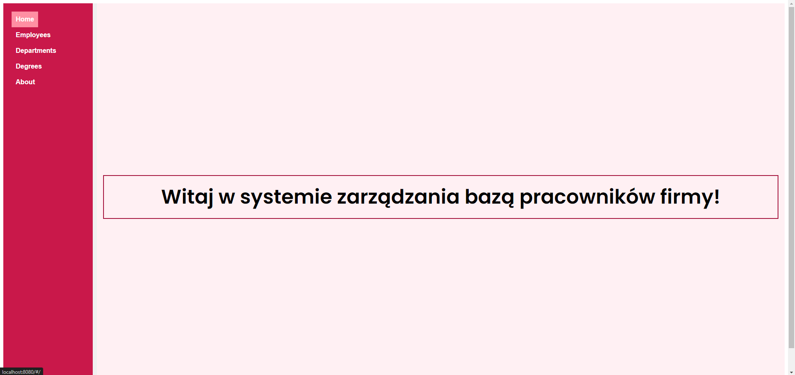
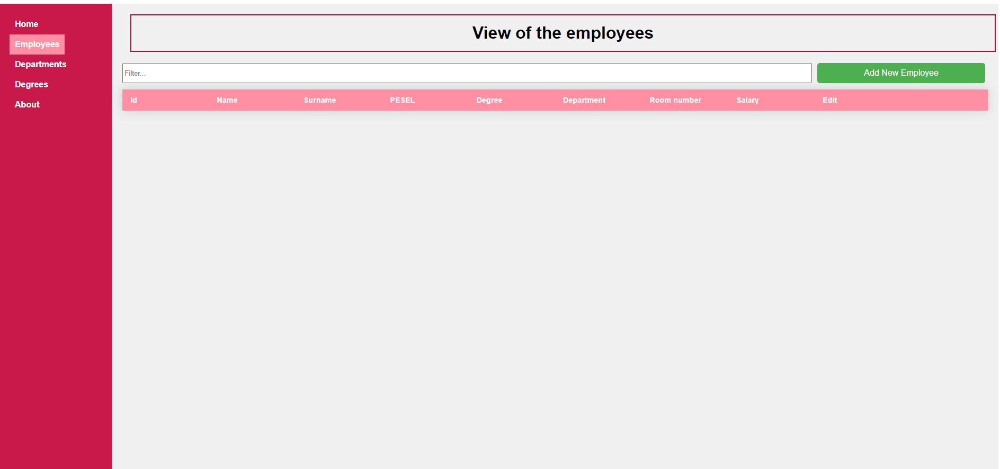
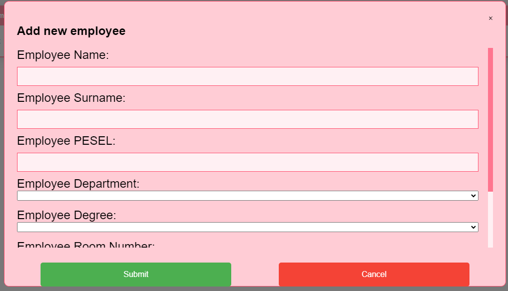
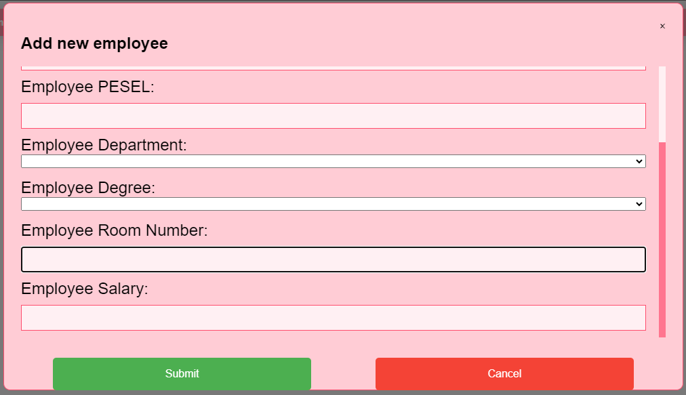
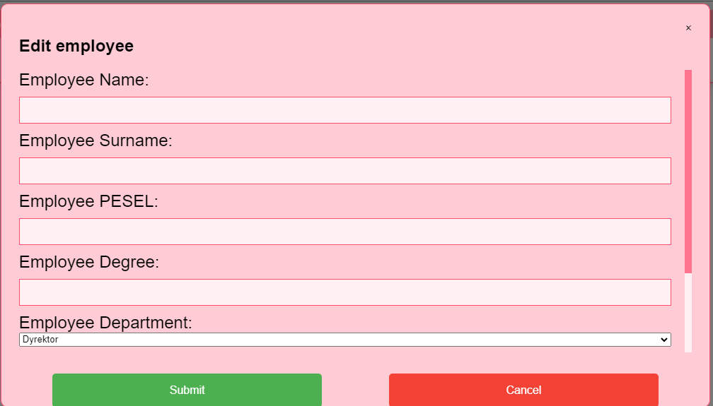
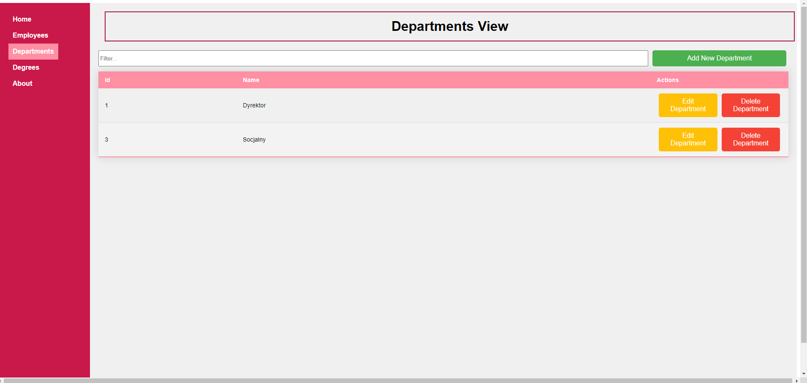
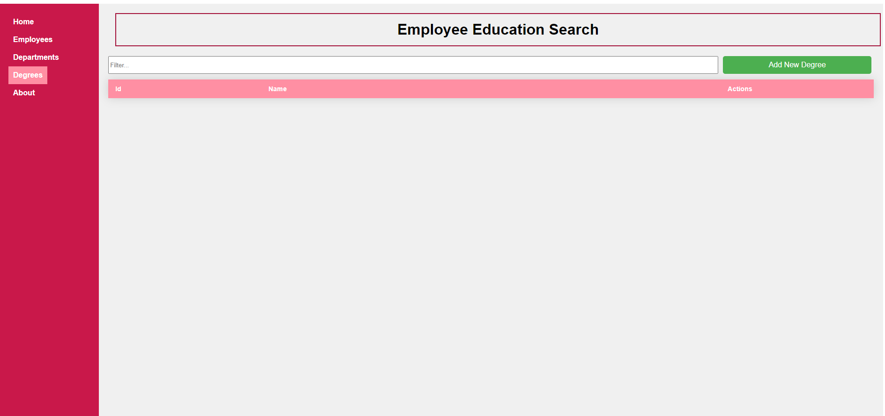

# Employees Management System

A full-stack web application for managing company data: employees, departments and academic degrees. The front end is built with **Vue.js**, the REST API with **Flask** and the data is stored in **SQLite**.



## Features

- **Employees**: view all employees in a table, filter them by any field, and add, edit or delete records. Each employee has a name, surname, PESEL number, degree, department, room number and salary.
- **Departments**: list, filter, add, rename and delete departments.
- **Degrees**: list, filter, add, rename and delete academic degrees.
- Department and degree names are resolved automatically in the employee table, so records stay linked by ID.
- Add and edit forms open in modal windows.

## Tech stack

| Layer | Technology |
|---|---|
| Front end | Vue 3, Vue Router, Axios |
| Back end | Python, Flask, Flask-CORS |
| Database | SQLite |

## Project structure

```
Employees-Management-System/
├── Backend/
│   ├── server.py              # Flask REST API (port 1234)
│   └── DatabaseInterface/     # Database access: Employee.py, Department.py, Degree.py
├── DB/
│   ├── Employees.db           # SQLite database
│   └── Export.sql             # Database schema
├── Website/                   # Vue.js front end
└── img/                       # Screenshots used in this README
```

## Getting started

### Requirements

- Python 3.8+
- Node.js 16+ and npm

### 1. Start the back end

From the repository root:

```sh
pip install flask flask-cors
python Backend/server.py
```

The API runs at `http://localhost:1234`. Run it from the repository root, because the database path (`./DB/Employees.db`) is relative to the current directory.

### 2. Start the front end

In a second terminal:

```sh
cd Website
npm install
npm run serve
```

Open `http://localhost:8080` in your browser.

## API endpoints

All write endpoints accept JSON in the request body.

| Method | Endpoint | Body |
|---|---|---|
| GET | `/get_all_employees` | – |
| POST | `/add_employee` | `Name`, `Surname`, `PESEL_number`, `Degree_Id`, `Departemnt_Id`, `Room_number`, `Salary` |
| POST | `/edit_employee` | `Id` + the fields above |
| POST | `/delete_employee` | `Id` |
| GET | `/get_all_departments` | – |
| POST | `/add_department` | `Name` |
| POST | `/edit_department` | `Id`, `Name` |
| POST | `/delete_department` | `Id` |
| GET | `/get_all_degrees` | – |
| POST | `/add_degree` | `Name` |
| POST | `/edit_degree` | `Id`, `Name` |
| POST | `/delete_degree` | `Id` |

## Database schema

- **Employees**: `Id`, `Name`, `Surname`, `PESEL_number` (unique), `Degree_Id` → Degree, `Departemnt_Id` → Department, `Room_number`, `Salary`
- **Department**: `Id`, `Name` (unique)
- **Degree**: `Id`, `Name`

The full schema is in [`DB/Export.sql`](./DB/Export.sql).

## Screenshots

**Employees view**



**Adding a new employee**





**Editing an employee**



**Departments view**



**Degrees view**



## Author

Natalia Kowal
